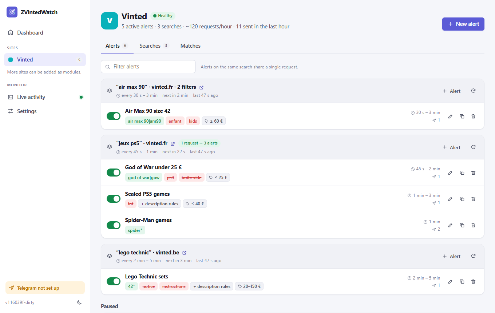
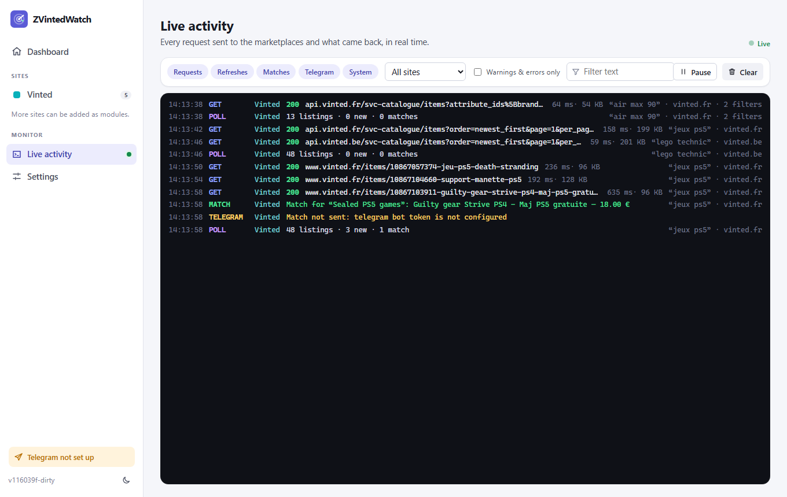
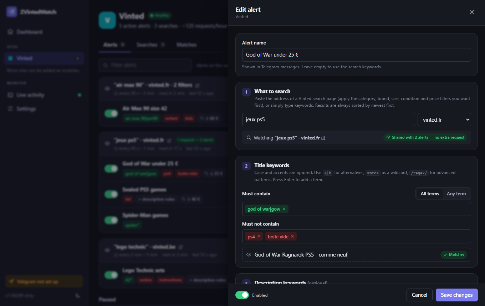

<div align="center">

# ZVintedWatch

**Get a Telegram message seconds after a matching item is listed on Vinted.**

Self-hosted · one small program · Windows, Linux, macOS, Raspberry Pi, seedboxes · no account needed

[](https://github.com/Nikola-Putnik/ZVintedWatch/actions/workflows/ci.yml)
[](https://github.com/Nikola-Putnik/ZVintedWatch/releases)
[](LICENSE)



</div>

## What is it?

Good deals on second-hand marketplaces disappear within minutes. ZVintedWatch watches the
marketplace for you and pings you on Telegram as soon as a new listing matches what you are
looking for.

You describe each **alert** in a web interface:

- **what to search**: paste the address of a Vinted search (with any filters: category, brand,
  size, condition, price…) or simply type keywords;
- **keywords** that must or must not appear in the **title** and/or the **description**
  (for example `god of war|gow`, but not `ps4` or `empty box`);
- an optional **price range**;
- how often to **refresh**: a fixed interval or a random one (e.g. every 30 s to 3 min);
- which **Telegram chats** get the matches: your private chat, or a channel shared with friends.

ZVintedWatch is built to be **multi-site**: each marketplace is a separate module and gets its own
section in the interface. Vinted is the first one; others (such as 2ememain / 2dehands /
Marktplaats) can be added without touching the rest of the application.

## Features

- 🔔 **Instant Telegram alerts** with the photo, price, brand, size, condition and a button to open the listing.
- 🎯 **Precise keyword rules**: accent- and case-insensitive, whole words, phrases, alternatives (`a|b`),
  wildcards (`spider*`), exclusions and even regular expressions — see [keyword syntax](docs/keyword-syntax.md).
- 🪶 **Request-saving engine**, designed to avoid IP bans:
  - alerts that use the same search **share a single request** — one search for “ps5 games” can feed
    an alert for *God of War*, another for *Spider-Man* and a third for sealed games only;
  - descriptions are **only downloaded when a listing already passes the title and price rules**,
    once per listing, and only partially;
  - requests are paced, jittered, and automatically paused when the site starts refusing them.
- 🧠 **No spam**: the first refresh only records the current listings; promoted listings and
  old listings pushed back to the top (“bumped”) are ignored; an item matching several alerts is sent once per chat.
- 🖥️ **Clean web interface**: dashboard, one section per site, alerts grouped by shared search,
  live preview of the rules on the current listings, light and dark themes, works on mobile.
- 📟 **Live activity console**: every request sent and what came back, in real time, like a terminal.
- 🌍 **Runs anywhere**: a single executable of ~20 MB with the interface built in. No runtime, no
  database server, no root access needed. Docker image available.
- 🔒 Password-protected interface when reachable from the network, optional proxies (HTTP/SOCKS5).



## Quick start

### 1. Download

Get the latest version from the [**Releases page**](https://github.com/Nikola-Putnik/ZVintedWatch/releases):

| Your machine | File to download |
|---|---|
| Windows PC | `zvintedwatch_<version>_windows_amd64.zip` (ARM PCs: `_windows_arm64.zip`) |
| Linux server or seedbox (Intel/AMD 64-bit) | `zvintedwatch_<version>_linux_amd64.tar.gz` |
| Raspberry Pi 4/5, ARM servers | `zvintedwatch_<version>_linux_arm64.tar.gz` |
| Older 32-bit Raspberry Pi | `zvintedwatch_<version>_linux_armv7.tar.gz` |
| Mac (Apple Silicon / Intel) | `zvintedwatch_<version>_darwin_arm64.tar.gz` / `_darwin_amd64.tar.gz` |

Docker users: `docker run -d -p 8080:8080 -v ./data:/data ghcr.io/nikola-putnik/zvintedwatch` (see [deployment](docs/deployment.md#docker)).

### 2. Start it

- **Windows**: extract the zip into a folder (e.g. `C:\ZVintedWatch`) and double-click
  `zvintedwatch.exe`. A console window stays open (that is the bot running) and the interface opens
  in your browser. If Windows SmartScreen warns about an unknown publisher, choose
  *More info → Run anyway*.
- **Linux / macOS**:
  ```sh
  tar -xzf zvintedwatch_*_linux_amd64.tar.gz
  ./zvintedwatch
  ```
  then open <http://127.0.0.1:8080>.

Everything ZVintedWatch stores (settings, alerts, history, logs) goes into a `data` folder next to
the executable.

### 3. Connect Telegram (2 minutes)

1. In Telegram, talk to [@BotFather](https://t.me/BotFather), send `/newbot` and follow the steps.
   It gives you a **token**.
2. In ZVintedWatch, open **Settings**, paste the token and click **Connect bot**.
3. Open your new bot in Telegram and press **Start**. Back in Settings, click **Add chat → Find
   chats**, pick yourself and send a test message.

Want several people to receive the alerts? Use a channel or a group — see the
[Telegram guide](docs/telegram-setup.md).

### 4. Create an alert

Open the **Vinted** section and click **New alert**. The easiest way:

1. On Vinted, search for what you want and apply the filters (category, brand, size, price…).
2. Copy the address from your browser's address bar and paste it in the alert.
3. Add title keywords if you want to narrow it down, check the **Preview**, and save.



That's it. The first refresh records the current listings; from then on, every new matching
listing is sent to Telegram.

## Running it on a server or a seedbox

ZVintedWatch is a single executable, so it runs fine on a Linux server, a NAS, a Raspberry Pi or a
seedbox without root access. You can also keep it on your PC and send its requests through another
machine with a proxy or an SSH tunnel. Step-by-step instructions (systemd, user services,
crontab, Docker, reverse proxy, SSH tunnels) are in **[docs/deployment.md](docs/deployment.md)**.

> **Good to know:** marketplaces block datacenter IP addresses more readily than home
> connections. If a seedbox or VPS gets blocked, run ZVintedWatch at home or use a residential proxy.

## Documentation

| Guide | What you will find |
|---|---|
| [Telegram setup](docs/telegram-setup.md) | Bot creation, private chats, channels and groups, troubleshooting |
| [Keyword syntax](docs/keyword-syntax.md) | How title/description rules work, with examples |
| [Deployment](docs/deployment.md) | Windows autostart, Linux service, seedbox, Docker, reverse proxy, updates, backups |
| [Configuration](docs/configuration.md) | Command-line options, environment variables, data folder, network settings |
| [How it works](docs/how-it-works.md) | Architecture, request saving, new-listing detection, anti-blocking measures |
| [Vinted notes](docs/providers/vinted.md) | How the Vinted module talks to Vinted and what to do when Vinted changes |
| [Adding a marketplace](docs/adding-a-provider.md) | Developer guide to write a new site module |
| [Contributing](CONTRIBUTING.md) | Building from source, development workflow, tests |

## FAQ

**Do I need a Vinted account?** No. ZVintedWatch only reads public search results, like a visitor would.

**Will I get blocked?** ZVintedWatch does everything it can to stay discreet (shared searches,
pacing, random intervals, a real browser fingerprint, automatic pauses). With reasonable intervals
(about a minute) and a home connection, a few dozen alerts are fine. Very short intervals on many
different searches increase the risk; the interface shows how many requests per hour you generate.

**How many alerts can I create?** As many as you like. What matters is the number of *different
searches* and their intervals: ten alerts on the same search cost the same as one.

**Can my friends get the alerts too?** Yes: send them to a Telegram channel or group (see the
[Telegram guide](docs/telegram-setup.md)), or give each person their own chat.

**Does it buy things or message sellers?** No. It only notifies you; you stay in control.

**Is my data sent anywhere?** No. Everything stays on the machine running ZVintedWatch. It only
talks to the marketplaces you watch and to the Telegram Bot API.

## Building from source

Requirements: [Go](https://go.dev/dl/) 1.27+ and [Node.js](https://nodejs.org/) 20+.

```sh
git clone https://github.com/Nikola-Putnik/ZVintedWatch.git
cd ZVintedWatch
./scripts/build.sh            # Windows: powershell -File scripts\build.ps1
./bin/zvintedwatch_<os>_<arch>
```

See [CONTRIBUTING.md](CONTRIBUTING.md) for the development workflow.

## Disclaimer

ZVintedWatch is an independent open-source project. It is **not affiliated with, endorsed by or
sponsored by Vinted** or any other marketplace; all trademarks belong to their owners. It is meant
for personal use: keep refresh intervals reasonable and respect the terms of use of the websites
you monitor. The authors are not responsible for how the software is used.

## License

[MIT](LICENSE)
